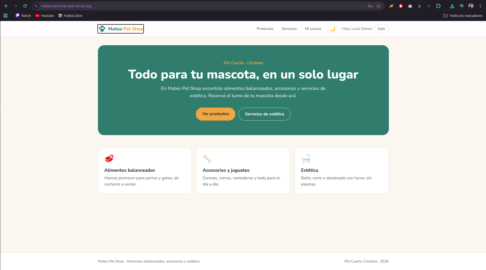
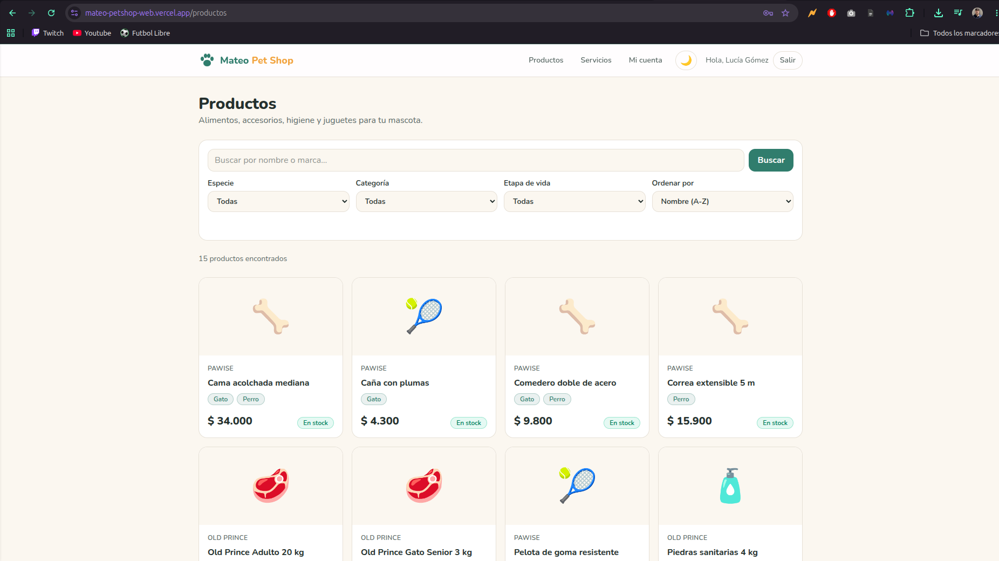
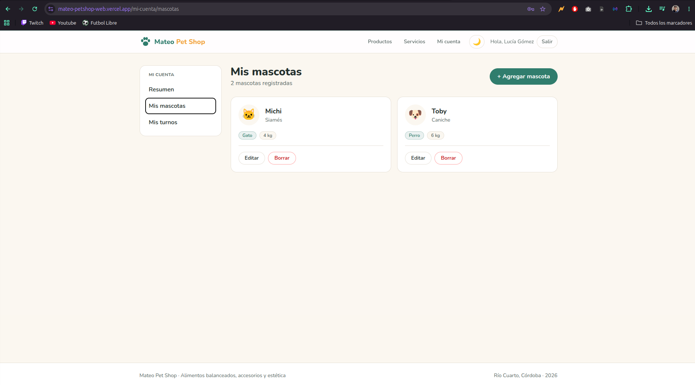
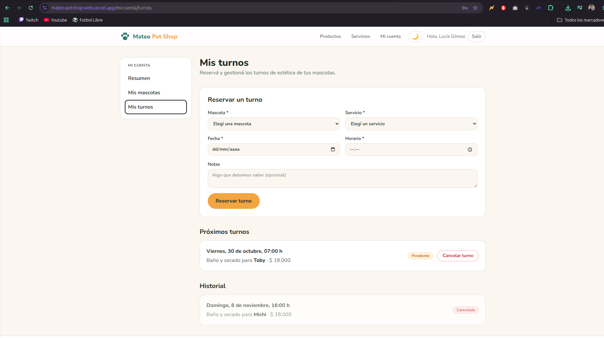
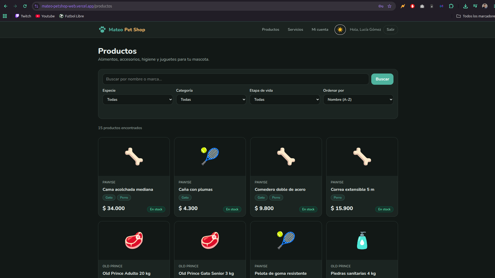

# Mateo Pet Shop — Web

Frontend de **Mateo Pet Shop**, tienda de alimentos balanceados, accesorios y servicios de estética para mascotas de Río Cuarto. Permite recorrer el catálogo con filtros, ver los servicios y, con una cuenta, administrar las mascotas propias y reservar turnos de estética.

Consume la API REST hecha en Django para Ingeniería de Software: [mateo-petshop-api](https://github.com/FranAmbrogio7/mateo-petshop-api).



## Links

| | URL |
| --- | --- |
| Sitio online | https://mateo-petshop-web.vercel.app |
| API online | https://mateo-petshop-api.onrender.com/api/ |
| Documentación de la API (Swagger) | https://mateo-petshop-api.onrender.com/api/docs/ |
| Repositorio de la API | https://github.com/FranAmbrogio7/mateo-petshop-api |
| Tablero Kanban | https://github.com/users/FranAmbrogio7/projects/1 |

> La API está en el plan gratuito de Render, que la suspende después de 15 minutos sin uso. Si es la primera visita del día, la primera página que pide datos puede tardar cerca de un minuto.

**Usuario de prueba:** `cliente_demo` / `demo12345`

## Funcionalidades

- **Catálogo** de productos paginado, con búsqueda, filtros por especie, categoría y etapa de vida, y orden por nombre, precio o novedad. Los filtros viven en la URL, así que se pueden compartir y el botón "atrás" funciona.
- **Detalle de producto** con marca, especies, stock y precio.
- **Servicios** de estética con duración, precio y especies a las que aplican.
- **Login** con el token de la API guardado en una cookie `httpOnly`.
- **Mi cuenta** (protegida): resumen, CRUD completo de mascotas y reserva y cancelación de turnos.
- **Modo claro y oscuro** que se recuerda entre visitas.
- Estados de **carga**, **error** y **lista vacía** en cada sección, y página 404 propia.

## Tecnologías

| Herramienta | Uso |
| --- | --- |
| Next.js 16 (App Router) | rutas, Server Components, Server Actions y `proxy.ts` |
| React 19 + TypeScript | componentes y tipado de los datos de la API |
| Tailwind CSS 4 | estilos, paleta con variables CSS y modo oscuro |
| React Hook Form + Zod | formularios y validación de mascotas, turnos y login |
| Vitest + Testing Library | tests unitarios y de componentes |
| Vercel | despliegue |

## Cómo funciona

- **Todas las llamadas a la API salen del servidor de Next**, desde `src/lib/api.ts` (marcado `server-only`). El navegador nunca habla con Django: por eso no hace falta CORS y el token nunca queda expuesto en JavaScript.
- **Sesión:** al iniciar sesión, una Server Action pide el token a `/api/auth/login/` y lo guarda en la cookie `httpOnly` `mateo_token`. Cada consulta protegida lo manda en el header `Authorization: Token ...`.
- **Rutas protegidas:** `src/proxy.ts` revisa la cookie en todo `/mi-cuenta/*` y, si no hay sesión, redirige a `/login?siguiente=...` para volver a la página pedida después de entrar.
- **Altas, ediciones y bajas** se hacen con Server Actions (`src/app/actions/`), que muestran los errores de validación de la API en el formulario y refrescan la página con `revalidatePath`.
- **Contextos:** `ThemeContext` (tema claro/oscuro) y `SesionContext` (usuario logueado para los componentes de cliente).

### Estructura

```text
src/
├── app/
│   ├── actions/          # Server Actions: auth, mascotas, turnos
│   ├── login/
│   ├── mi-cuenta/        # área privada: resumen, mascotas, turnos
│   ├── productos/        # listado con filtros y detalle [id]
│   ├── servicios/
│   ├── layout.tsx        # navbar, footer, tema y sesión
│   └── page.tsx          # inicio
├── components/           # tarjetas, formularios, filtros, paginación, etc.
├── context/              # ThemeContext y SesionContext
├── lib/                  # cliente de la API, sesión, esquemas Zod, formato y tipos
├── __tests__/            # tests con Vitest
└── proxy.ts              # protección de /mi-cuenta
```

## Capturas

### Catálogo con filtros



### Mis mascotas



### Reserva de turnos



### Modo oscuro



## Instalación local

### Requisitos

- Node.js 20.9 o superior (desarrollado con Node 24)
- La API corriendo: la online de Render o una local (ver el [README de la API](https://github.com/FranAmbrogio7/mateo-petshop-api#instalación-local))

### Pasos

```bash
git clone https://github.com/FranAmbrogio7/mateo-petshop-web.git
cd mateo-petshop-web
npm install
cp .env.example .env.local
npm run dev
```

El sitio queda en http://localhost:3000.

### Variables de entorno

| Variable | Descripción | Ejemplo |
| --- | --- | --- |
| `API_URL` | URL base de la API, sin barra final. Solo se usa en el servidor. | `https://mateo-petshop-api.onrender.com` o `http://127.0.0.1:8000` |

### Scripts

| Comando | Qué hace |
| --- | --- |
| `npm run dev` | servidor de desarrollo |
| `npm run build` | build de producción |
| `npm run start` | sirve el build de producción |
| `npm run lint` | revisa el código con ESLint |
| `npm run test` | corre los tests una vez |
| `npm run test:watch` | corre los tests en modo observador |

## Tests

```bash
npm run test
```

25 tests con Vitest y Testing Library:

- `formato.test.ts`: precios, estado de stock, armado de la query de filtros, edad de la mascota y fechas en hora argentina.
- `schemas.test.ts`: validaciones de Zod de login, mascota (largo del nombre, especie, fecha de nacimiento y peso) y turno (horario de 9 a 18 y fecha futura).
- `componentes.test.tsx`: renderizado de `EstadoVacio` y `Badge`.

## Despliegue

El sitio está en **Vercel**, conectado al repositorio: cada merge a `main` genera un despliegue de producción y cada otra rama una vista previa. La única configuración es la variable `API_URL` en *Settings → Environment Variables*.

## Organización del trabajo

- **Kanban** en GitHub Projects con una tarjeta por etapa, cerrada desde su Pull Request: https://github.com/users/FranAmbrogio7/projects/1
- **GitFlow:** `main` para la versión entregable, `develop` para integración y una rama `feature/*` por etapa, cada una con su Pull Request.
- **Commits** con Conventional Commits (`feat`, `fix`, `test`, `docs`, `chore`, `style`).

## Autor

**Francisco Ambrogio** — Tecnicatura Superior en Desarrollo de Software, ITEC Río Cuarto.
Programación III · Evaluación Final Integradora 2026.
